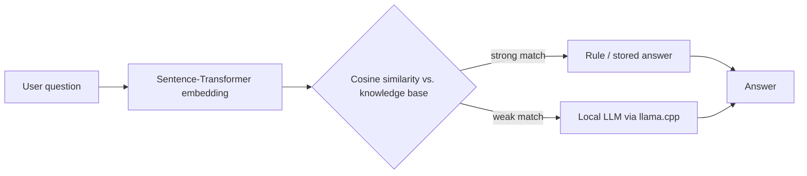

# 💬 BRIHA · Hybrid AI Chatbot


    

> ⚡ **Part of [BRIHA](https://github.com/asad110abbas)** · Briha Research, built by Syed Asad Abbas.

A conversational agent that combines **semantic search over a knowledge base** with a **locally-run LLM**, so
answers stay grounded in your own data while still sounding natural, all without paid APIs.

## How it works


## Highlights
- **Hybrid intelligence:** predictable rule-based answers for known intents, plus an LLM for open questions
- **Semantic retrieval:** knowledge base embedded with Sentence-Transformers and matched with cosine similarity (scikit-learn)
- **Runs locally:** GGUF model served through `llama-cpp-python`, so no API keys and no per-token cost
- **Fast startup:** embeddings cached with `pickle`

## Notebook walkthrough
1. **Move model into the Colab workspace**
2. **Embed the knowledge base** (pandas → Sentence-Transformers)
3. **Create the model** (llama.cpp)
4. **Answer pipeline** with similarity threshold and fallback

## Run
Open `AI Hybrid ChatBot.ipynb` in Jupyter or Google Colab and run the cells top to bottom.
```bash
pip install llama-cpp-python sentence-transformers scikit-learn pandas
```
